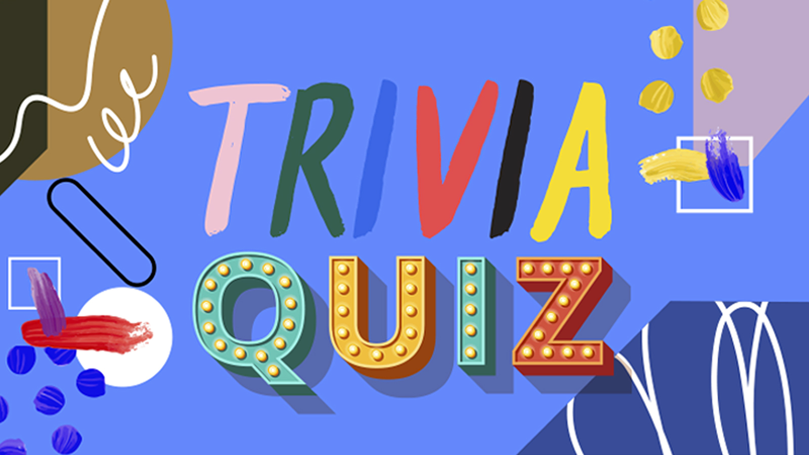
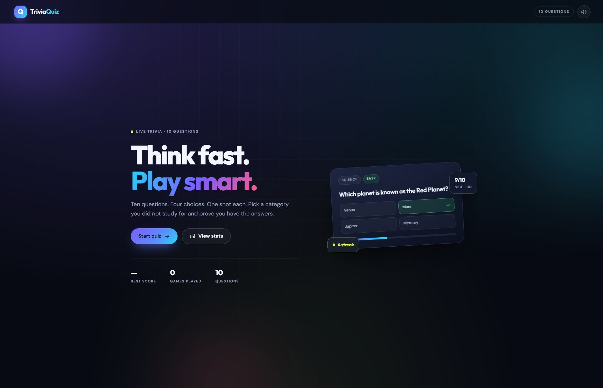
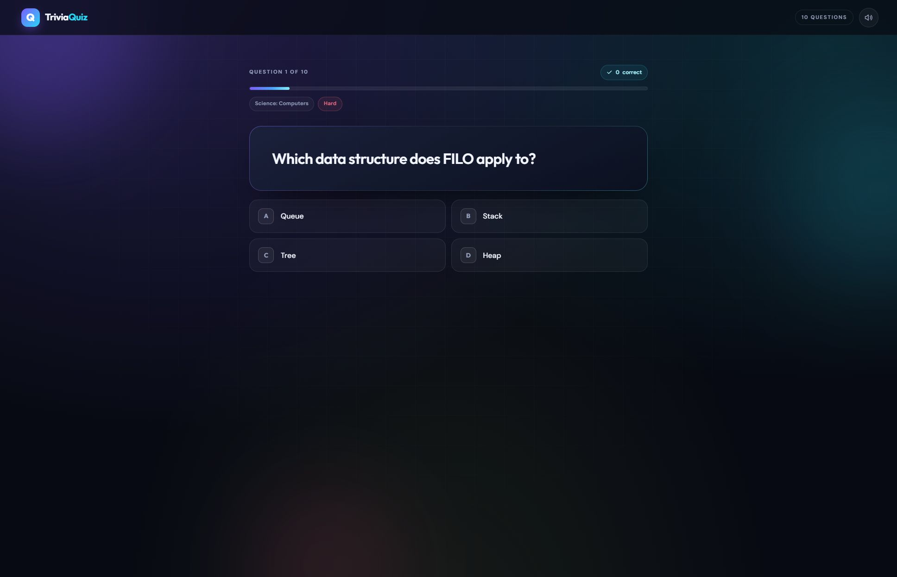
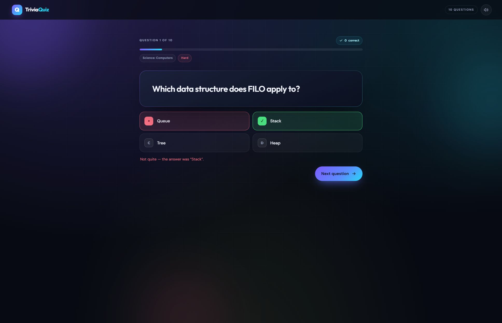
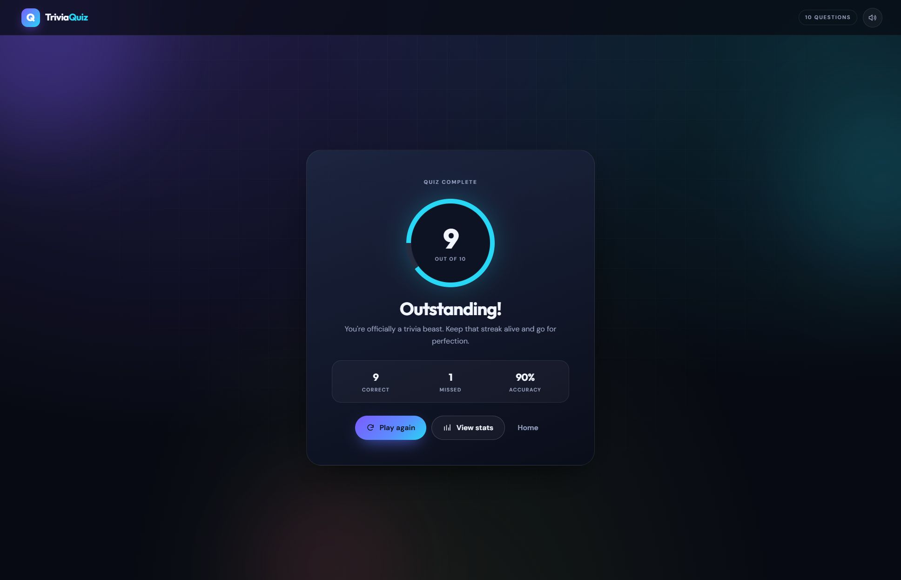
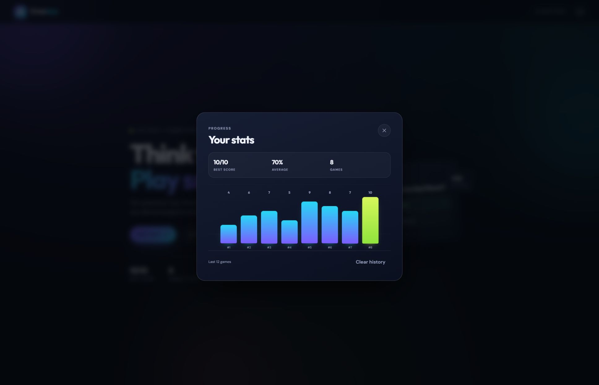

<div align="center">
  <a href="https://github.com/Yorch82/Proyecto-SPA--Quizz-">
    
  </a>

  <h3 align="center">Proyecto SPA Quiz</h3>

  <p align="center">
    Una single page application de trivia: 10 preguntas, 4 respuestas y una sola oportunidad.
    <br />
    Interfaz oscura, responsive y estadísticas que se guardan entre partidas.
  </p>

  <br>
</div>

<details>
  <summary>Índice</summary>
  <ol>
    <li><a href="#sobre-el-proyecto">Sobre el proyecto</a></li>
    <li><a href="#características">Características</a></li>
    <li><a href="#herramientas-utilizadas">Herramientas utilizadas</a></li>
    <li><a href="#empezando">Empezando</a></li>
    <li><a href="#guía-de-uso">Guía de uso</a></li>
    <li><a href="#mejoras-del-rediseño">Mejoras del rediseño</a></li>
    <li><a href="#contacto">Contacto</a></li>
  </ol>
</details>

<br>

<!-- SOBRE EL PROYECTO -->
## Sobre el proyecto

El proyecto consiste en crear una single page application en la que se muestra un Quiz.

Características principales:

* El Quiz consta de **10 preguntas**. Cada pregunta tiene **4 opciones** y solo una es correcta.
* Las preguntas se obtienen de [Open Trivia DB](https://opentdb.com/).
* La aplicación es una **SPA**: solo se muestra una pregunta cada vez, sin recargar la página.
* El resultado final incluye la puntuación, el porcentaje de aciertos y un histórico de partidas.

<br>

<figure>
  
  <figcaption align="center"><em>Pantalla de inicio</em></figcaption>
</figure>

<br>

<!-- CARACTERÍSTICAS -->
## Características

* Interfaz moderna con tema oscuro, tarjetas glassmorphism y gradientes.
* Diseño responsive para escritorio, tablet y móvil.
* Preguntas y respuestas con entidades HTML correctamente decodificadas.
* Barra de progreso y contador de pregunta.
* Puntuación en vivo, racha de aciertos y feedback inmediato.
* Respuesta correcta marcada en verde y respuesta fallada en rojo.
* Botón de siguiente pregunta con soporte para teclado.
* Resultados con anillo de puntuación, aciertos, fallos y precisión.
* Histórico de partidas persistente en `localStorage`.
* Gráfica de las últimas 12 partidas y resumen de mejores resultados.
* Control de sonido persistente y sonido final según la puntuación.
* Manejo de errores y reintento automático si la API falla.
* Accesibilidad: foco visible, navegación por teclado, `aria-live`, modal con foco atrapado y respeto a `prefers-reduced-motion`.

<br>

<!-- HERRAMIENTAS -->
### Herramientas utilizadas

Esta sección incluye el lenguaje de etiquetado, maquetación y programación empleado:

* [HTML5](https://html.com/)
* [CSS3](https://www.w3schools.com/css/)
* [JavaScript](https://www.javascript.com/)
* [Open Trivia DB](https://opentdb.com/) — API de preguntas
* [Google Fonts](https://fonts.google.com/) — tipografías Outfit y DM Sans

<br><br>

<!-- EMPEZANDO -->
## Empezando

El proyecto no necesita instalación ni build: es HTML, CSS y JavaScript puro.

### Opción 1 — Abrir directamente

Abre `index.html` en el navegador.

### Opción 2 — Servidor local (recomendado)

```bash
git clone https://github.com/Yorch82/Proyecto-SPA--Quizz-.git
cd Proyecto-SPA--Quizz-
python -m http.server 8000
```

Después abre [http://localhost:8000](http://localhost:8000).

> La app necesita conexión a internet para cargar las preguntas de Open Trivia DB y las tipografías de Google Fonts.

<br><br>

<!-- GUÍA DE USO -->
## Guía de uso

### 1. Pantalla de inicio

Desde la pantalla principal puedes empezar una partida o consultar tus estadísticas. También se muestra tu mejor puntuación y el número de partidas jugadas.

<figure>
  
  <figcaption align="center"><em>Pantalla de inicio con el mejor resultado</em></figcaption>
</figure>

<br>

### 2. Una pregunta cada vez

Al pulsar **Start quiz** se cargan 10 preguntas. Cada pantalla muestra la categoría, la dificultad, el progreso y las cuatro respuestas posibles. En escritorio también puedes responder con las teclas `1`–`4` o `A`–`D`.

<figure>
  
  <figcaption align="center"><em>Pregunta con las cuatro opciones</em></figcaption>
</figure>

<br>

### 3. Respuesta correcta e incorrecta

Al responder, la opción correcta se marca en verde y la incorrecta en rojo. El resto de opciones se atenúan para centrar la atención en el resultado. Después aparece el botón **Next question** (o **See results** en la última pregunta).

<figure>
  
  <figcaption align="center"><em>Feedback inmediato después de responder</em></figcaption>
</figure>

<br>

### 4. Resultados

Al terminar las 10 preguntas se muestra la puntuación final, el porcentaje de aciertos y un mensaje según el rendimiento. Desde aquí puedes volver a jugar, consultar las estadísticas o volver al inicio.

<figure>
  
  <figcaption align="center"><em>Resultado de la partida</em></figcaption>
</figure>

<br>

### 5. Estadísticas

El modal de estadísticas muestra la mejor puntuación, la media y el histórico de las últimas 12 partidas. El historial se conserva aunque cierres el navegador.

<figure>
  
  <figcaption align="center"><em>Historial de puntuaciones</em></figcaption>
</figure>

<br>

### Atajos de teclado

| Tecla | Acción |
| --- | --- |
| `1` / `A` | Seleccionar la primera respuesta |
| `2` / `B` | Seleccionar la segunda respuesta |
| `3` / `C` | Seleccionar la tercera respuesta |
| `4` / `D` | Seleccionar la cuarta respuesta |
| `Enter` | Pasar a la siguiente pregunta cuando está disponible |
| `Esc` | Cerrar el modal de estadísticas |

<br>

<!-- MEJORAS -->
## Mejoras del rediseño

- [x] Nueva identidad visual: tema oscuro, gradientes y tarjetas glassmorphism.
- [x] Layout responsive sin anchos fijos ni desbordamientos en móvil.
- [x] Corrección de entidades HTML en preguntas y respuestas (`&quot;`, `&#039;`, `&amp;`, etc.).
- [x] Sustitución de Axios por `fetch` nativo con timeout, reintento y mensajes de error.
- [x] Eliminación de Chart.js: gráfica ligera propia, sin dependencias externas.
- [x] Historial de partidas persistente y migrado a una estructura con puntuación y total.
- [x] Barra de progreso corregida: avanza de la pregunta 1 a la 10 y llega al 100%.
- [x] Flujo de resultados simplificado: el botón de la última pregunta muestra los resultados.
- [x] Sonido final controlado con un único reproductor y opción de silenciar.
- [x] Mensajes de feedback, racha de aciertos y puntuación en vivo.
- [x] Accesibilidad y navegación por teclado.
- [x] Favicon propio y metadatos de la página.
- [x] Documentación actualizada con capturas del nuevo diseño.

### Retos superados

- [x] Estructura básica HTML
- [x] Barra de navegación
- [x] Contenedores de preguntas y respuestas
- [x] Flexbox y CSS Grid
- [x] Diseño responsive
- [x] Gráfica de estadísticas
- [x] Barra de progreso
- [x] Uso de localStorage
- [x] Petición de datos a APIs
- [x] Aleatorización de respuestas
- [x] Gestión de falsos clics
- [x] Gestión de puntuación
- [x] Control de asincronías
- [x] Modal de estadísticas
- [x] Gestión de caracteres especiales
- [x] Refactorización del código
- [x] Sonidos según la puntuación
- [x] Manejo de errores de red
- [x] Accesibilidad y atajos de teclado

<br>

<!-- CONTACTO -->
## Contacto

- [Jorge](mailto:jcampo1982@outlook.com "Contáctame")
- [Germán](mailto:moltorger@gmail.com "Hola!")

## Autores

- Jorge Campo — [GitHub](https://github.com/Yorch82 "Jorge Campo")
- Germán Molero — [GitHub](https://github.com/Molerog "Germán Molero")
